# Atlas Agent OS

[English](README.md) | [简体中文](README.zh-CN.md)

Atlas Agent OS is an Electron desktop workstation for digital-asset trading. It combines Binance market data and order operations, persistent strategy Agents, AI supervision, Skills, MCP tools, deterministic risk checks, and execution audit logs in one local application.

> [!WARNING]
> Atlas can submit real orders after Binance Live is configured. Use a dedicated API key with withdrawals disabled, the smallest necessary Spot/Futures permissions, and an IP whitelist. Validate every workflow in Paper and Testnet before using Live. This software is not investment advice and does not promise profitability.

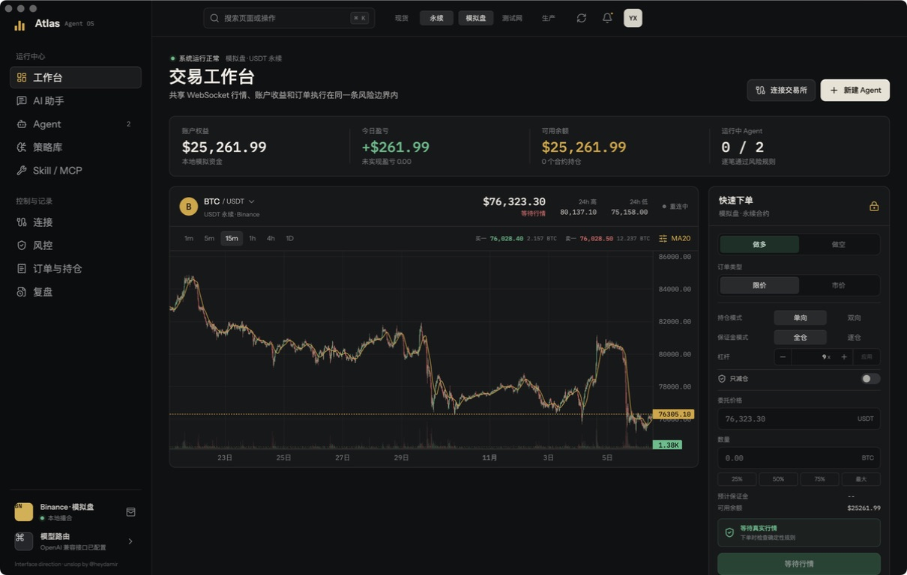

## Contents

- [Product scope](#product-scope)
- [Desktop interface tour](#desktop-interface-tour)
- [Environments and markets](#environments-and-markets)
- [Binance setup](#binance-setup)
- [Model setup](#model-setup)
- [Skills and MCP setup](#skills-and-mcp-setup)
- [Agent execution model](#agent-execution-model)
- [Backtest methodology](#backtest-methodology)
- [Installation and packaging](#installation-and-packaging)
- [Architecture and security](#architecture-and-security)
- [Known boundaries](#known-boundaries)

## Product scope

Atlas is a desktop application, not a browser-only trading page. The React renderer displays data and collects user intent; the Electron main process owns encrypted credentials, signed exchange requests, WebSockets, AI calls, MCP sessions, Agent scheduling, and persistent runtime state.

The current release provides:

- Paper, Binance Testnet, and Binance Live environments.
- Binance Spot and USDT-M Futures, including one-way/hedge position modes, cross/isolated margin, `1-125x` leverage, and isolated-margin adjustment.
- Shared Spot/Futures WebSockets, all Binance-tradable USDT Spot pairs and USDT perpetuals returned by exchange metadata, best bid/ask, 24-hour statistics, and live K-lines.
- Market/limit entry, partial/full closing, order history, live position PnL, liquidation and margin information.
- Editable autonomous Agents with seven executable strategies, long/short/automatic direction, AI supervision, Skills, MCP tool allowlists, deterministic risk checks, and step-by-step logs.
- Persistent AI conversations and provider routing for hosted, gateway, and local models.
- Closed-candle backtests with chronological holdout, next-open reference fills, cost assumptions, an equity curve, and trade-level audit data.
- Review/export views and a global risk stop.

Atlas has no withdrawal endpoint or withdrawal capability.

## Desktop interface tour

### 1. Trading workbench


The workbench is the operating screen for manual trading and live monitoring.

| Area | What it does |
| --- | --- |
| Top market switch | Changes Spot/Futures and Paper/Testnet/Live. The active choice is used by account, orders, positions, chart subscriptions, and newly created Agents. |
| Refresh button | Refreshes account, orders, market subscriptions, and Agent status. Prices normally continue through shared WebSockets without manual refresh. |
| Account strip | Shows wallet equity, available balance, daily/realized information where available, and running Agent count. |
| Symbol and interval | Selects a Binance-tradable USDT Spot pair or USDT perpetual and `1m / 5m / 15m / 1h / 4h / 1d`. Switching cancels the old topic and rejects late data from it. |
| Chart | Loads up to 2,000 historical candles and merges the current WebSocket candle. The status indicates live, reconnecting, or stale data. |
| Order ticket | Chooses long/buy or short/sell, market/limit, one-way/hedge, cross/isolated, leverage, reduce-only, price, quantity, and percentage presets. |
| Current positions | Shows entry/cost price, latest price, size, margin, liquidation price, unrealized PnL, and return basis. A row opens the close-position workflow. |
| Agent status and decision stream | Shows running/paused state, strategy, AI mode, linked position PnL, and persisted runtime events. |

Futures leverage, margin mode, and position mode are account settings, not order fields. Margin/position mode buttons apply immediately; a changed leverage value applies only after clicking **Apply**. Confirm that Binance accepted each change before ordering. Isolated positions expose add/remove-margin controls. The close dialog supports market or limit orders plus `25% / 50% / 75% / all`; one-way Futures closes with reduce-only semantics, while hedge mode closes the selected `LONG` or `SHORT` side. Spot cannot open a naked short.

Between account snapshots the selected symbol's unrealized PnL is estimated from the latest public trade price; Futures margin/liquidation fields remain from the latest account/`positionRisk` snapshot. Spot portfolio totals are not a substitute for a complete tax/accounting ledger because Binance Spot does not expose one unified real-time cost and daily-PnL record.

### 2. AI Assistant and conversation history

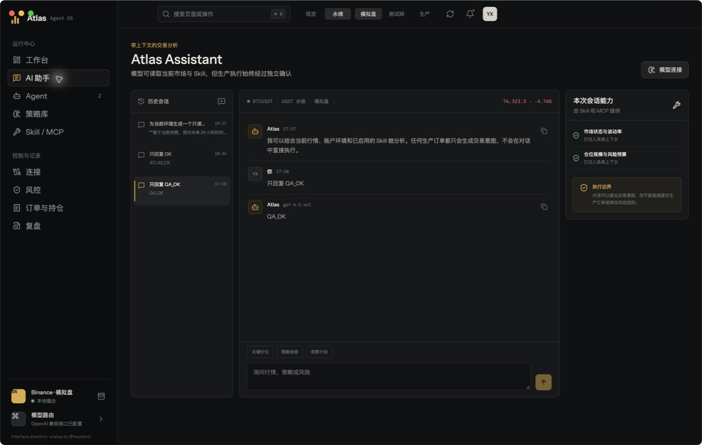

The Assistant is a market-analysis workspace, not a direct production order console.

- **History column:** creates, selects, and preserves local conversations across restarts.
- **Market header:** injects the current environment, market, symbol, price, and available account context.
- **Conversation:** renders Markdown and provides copy actions. Responses currently arrive as complete responses rather than token streaming.
- **Quick prompts:** start common price-level, strategy-check, and observation-plan requests.
- **Session capabilities:** lists enabled Skills and discovered MCP tools included in the current conversation.
- **Execution boundary:** chat can analyze or propose a structured intent, but cannot bypass risk rules or directly submit a production order.

If chat reports `ECONNREFUSED 127.0.0.1:<port>`, the selected local gateway is not listening at the saved Base URL. Start CCSwitch/Ollama/LM Studio, correct the port, then use **Connections -> Models and reasoning -> Test connection and refresh models**.

### 3. Agent runtime and step-by-step logs

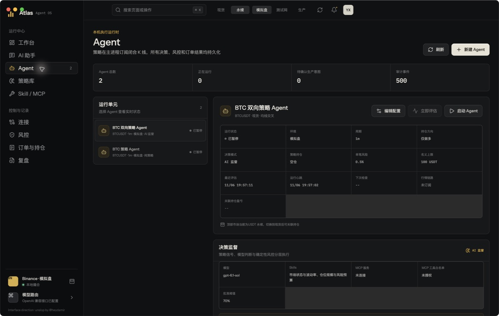

The Agent page controls runtime units that continue evaluating while the desktop process is running.

- Select an Agent to inspect its environment, market, symbol, interval, strategy, direction policy, risk per trade, notional cap, linked position, and heartbeat.
- Use **Edit configuration** to change an existing Agent. An Agent can use Spot or Futures and long-only, short-only, or automatic direction; Spot remains long-only at execution time.
- Use **Start/Pause** to control subscriptions. A running Agent restores its subscription after an Electron restart; a paused Agent remains paused.
- **Evaluate now** requests an immediate check when the runtime and market subscription are ready.
- **Decision supervision** shows strategy-only or AI-supervised mode, model, Skills, MCP server, tool allowlist, confidence threshold, and fail-closed policy.
- **Execution timeline** retains main-process steps such as market snapshot, signal evaluation, AI reasoning, risk rejection, order intent, production confirmation, submission, exchange response, fill/reconciliation, retry, and completion.

Agents evaluate closed candles only. On startup they inspect the latest closed candle, use WebSocket close events during normal operation, and use a REST watchdog after short disconnects. The runtime does not repeatedly act on the same candle.

An Agent's stop percentage currently sizes risk as `risk budget / stop distance`; it does not place exchange-native stop-loss/take-profit protection orders and it does not trigger intrabar. Live Agent strategy actions are market intents generated after a candle closes. Backtest stop and take-profit simulation must not be read as live protective-order support.

In **strategy-only** mode the deterministic strategy creates the candidate order. In **AI-supervised** mode the strategy still creates the candidate, then the model must approve it and every selected Skill/MCP requirement must succeed. Missing models, Skills, or MCP tools fail closed and produce `AI_REJECTED`; AI approval still cannot bypass local risk rules.

Paper and Testnet Agent orders may execute after risk approval. Live Agent orders become 30-second confirmation intents; confirmation refreshes price and runs the main-process risk checks again.

### 4. Strategy library

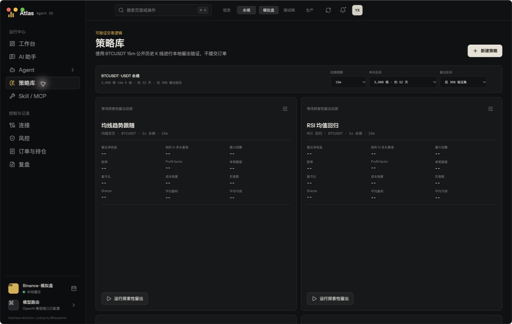

The strategy library contains seven strategy families also available to Agents. Defaults and signal intent are aligned, but the backtest and live runtime are separate implementations and are not guaranteed to produce identical trades for every historical sequence.

| Strategy | Typical purpose | Main editable parameters |
| --- | --- | --- |
| EMA/SMA crossover | Trend following | fast/slow periods and MA type |
| Donchian breakout | Channel breakout | breakout and exit lookbacks |
| RSI reversal | Mean reversion | RSI period and threshold |
| Bollinger reversion | Volatility-band reversion | period and standard-deviation multiplier |
| ATR breakout | Volatility expansion | ATR period and breakout multiplier |
| Supertrend | Volatility-adjusted trend | ATR period and multiplier |
| MACD momentum | Momentum confirmation | fast, slow, and signal periods |

Strategies can be created, renamed, edited, and persisted locally; user-created strategies can also be removed, while the seven built-in defaults remain available. Risk/cost inputs include position size, leverage, fixed stop, take-profit, trailing stop, fee, slippage, and an eight-hour funding-rate estimate. A run uses the current top-level market and symbol but never calls the order adapter.

The toolbar selects the candle interval, `1,000 / 2,000 / 5,000 / 10,000` closed candles, and a final `20% / 30% / 40%` chronological exploratory holdout.

### 5. Backtest detail and trade audit

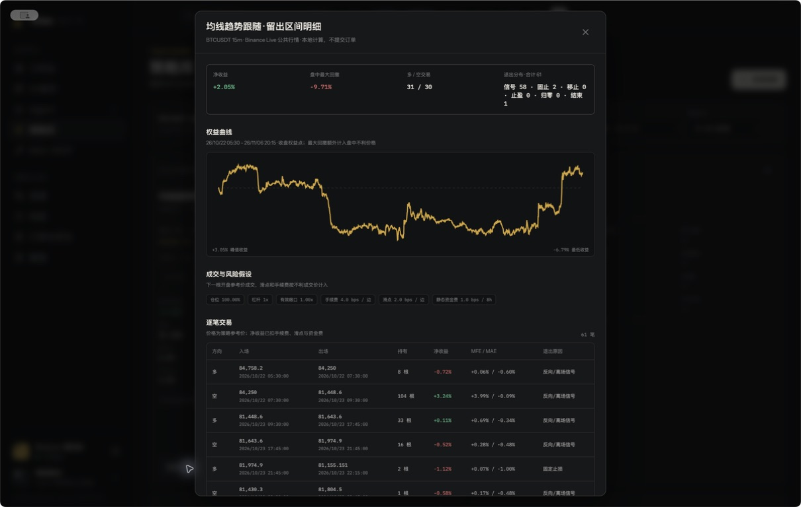

Open a completed strategy result to inspect:

- exact in-sample and holdout dates, requested candles, actual closed candles used, excluded open candles, data source, and detected gaps;
- net strategy return versus a 1x long benchmark, OHLC-based maximum drawdown, win rate, Profit Factor, expectancy, payoff ratio, Sharpe ratio, average win/loss, trade count, and cost drag;
- the holdout equity curve, long/short distribution, exit-reason distribution, and low-sample warnings;
- every trade's direction, next-open reference entry time/price, exit time/reference price, net return, holding period, OHLC-based MFE/MAE estimate, and exit reason.

The detail view is an audit aid, not evidence of future profitability. See [Backtest methodology](#backtest-methodology) for the exact accounting rules and limitations.

### 6. Skills and MCP

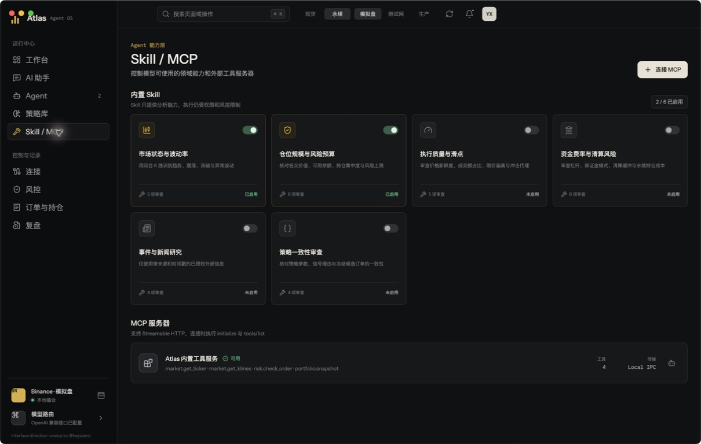

Skills are versioned analysis contracts that add bounded checks to Assistant and Agent context. Six built-ins cover market regime/volatility, position sizing/risk budget, execution quality/slippage, Futures funding/liquidation risk, sourced event/news research, and strategy consistency.

- The toggle enables a Skill globally for Assistant use.
- An Agent independently selects its Skills when edited; the runtime filters them by market applicability.
- A Skill receives bounded market/account/candidate-order inputs and declares required, optional, and prohibited inputs. It does not grant operating-system or exchange privileges.
- The page currently lists four reserved Local IPC contracts: `market.get_ticker`, `market.get_klines`, `risk.check_order`, and `portfolio.snapshot`. They are interface declarations in this release, not callable MCP/runtime tools.
- **Connect MCP** accepts an HTTP/HTTPS MCP endpoint, performs `initialize` and `tools/list`, and keeps the returned session ID.
- Each Agent has an explicit MCP tool allowlist. A connected server alone does not authorize every tool.

HTTP MCP with JSON or SSE response parsing is supported. Local stdio MCP servers are not currently supported. Remote tool output is untrusted input and any order-related result must return through local risk and confirmation controls.

### 7. Connections: exchange, model, and network

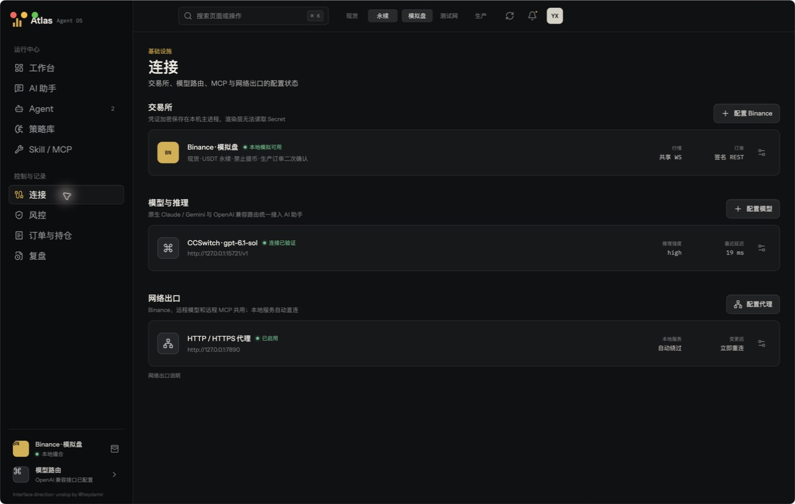

The Connections page is the status and configuration center.

- **Exchange:** saves separate Testnet/Live Binance credentials, tests signed access, and reports public WebSocket/signed REST state. Secrets are encrypted in the Electron main process and are never returned to the renderer.
- **Models and reasoning:** shows provider, selected model, health, reasoning effort, endpoint, and latest connection-test latency.
- **Network egress:** configures one HTTP/HTTPS proxy for Binance, remote models, and remote MCP. Localhost, `127.0.0.1`, and `::1` bypass it automatically; applying a change reconnects market data.

Proxy precedence is `ATLAS_PROXY_URL`, then `HTTPS_PROXY`, then `HTTP_PROXY`, then the encrypted in-app setting.

### 8. Model provider and reasoning configuration

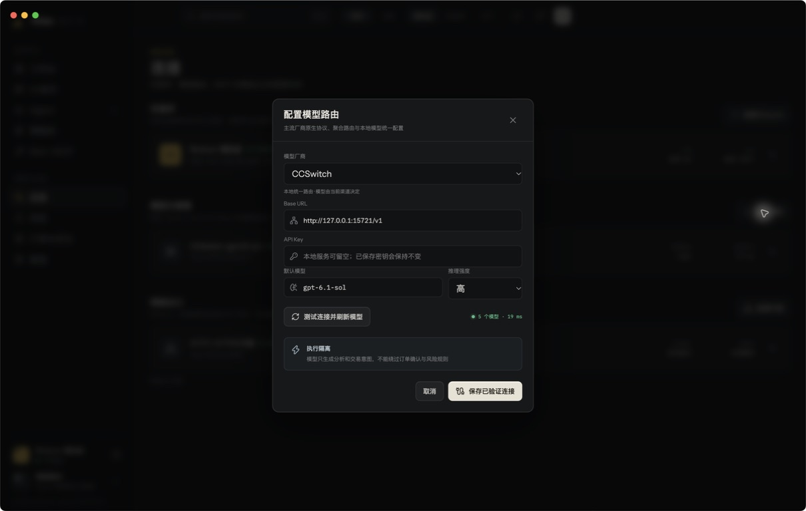

The model dialog supports OpenAI Responses/compatible APIs, native Anthropic Messages, and native Google Gemini routing. Presets are provided for OpenAI, Anthropic Claude, Google Gemini, DeepSeek, Alibaba Qwen, Moonshot Kimi, MiniMax, OpenRouter, CCSwitch, Ollama, LM Studio, and a custom OpenAI-compatible service.

1. Select a provider preset or custom compatible endpoint.
2. Review/edit the Base URL and enter its API key. Local providers may allow an empty key.
3. Click **Test connection and refresh models**. Atlas queries the provider when discovery is available.
4. Choose a discovered model from the dropdown or type an exact model ID.
5. Select the provider-supported reasoning effort, from disabled/low through higher levels where applicable.
6. Save only after the connection test succeeds.

Provider model catalogs change frequently; model discovery and manual entry are authoritative over bundled suggestions. Use a fixed model instead of an automatic router when reproducible Agent audit decisions matter.

### 9. Deterministic risk control

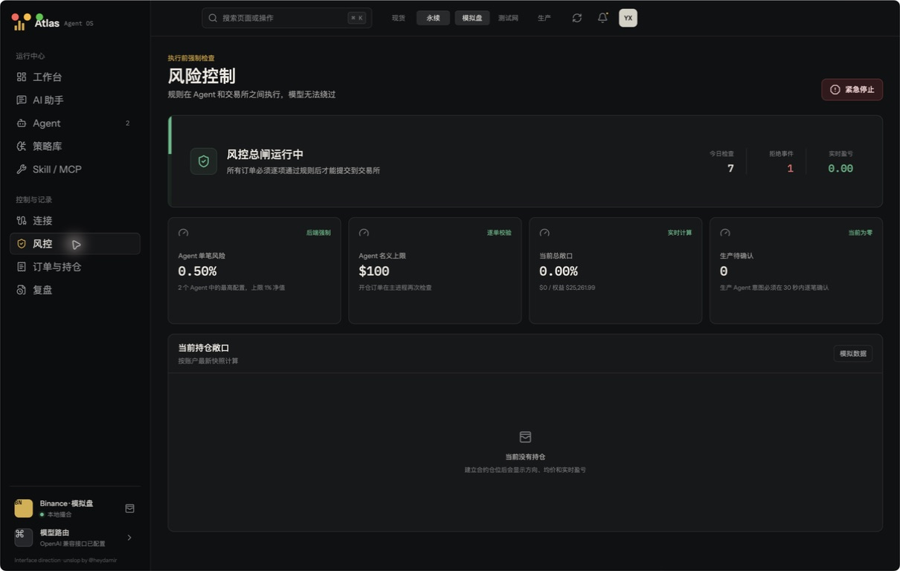

Checks execute between intent and the exchange adapter. Manual orders receive field validation, exchange filters, and the global halt; Agents additionally receive risk-per-trade sizing, notional/quantity, balance, and direction checks. The dashboard shows the strictest Agent setting, notional cap, current exposure, pending Live confirmations, daily check count, rejection count, and positions contributing to exposure.

The **Emergency stop** rejects new order submissions only. It does not cancel existing orders, close positions, stop market analysis, or persist across an application restart. It is a local workstation control, not an exchange-hosted kill switch; inspect and act on the Binance account independently. Models and MCP tools cannot bypass the checks that are implemented.

### 10. Orders, positions, and trade PnL

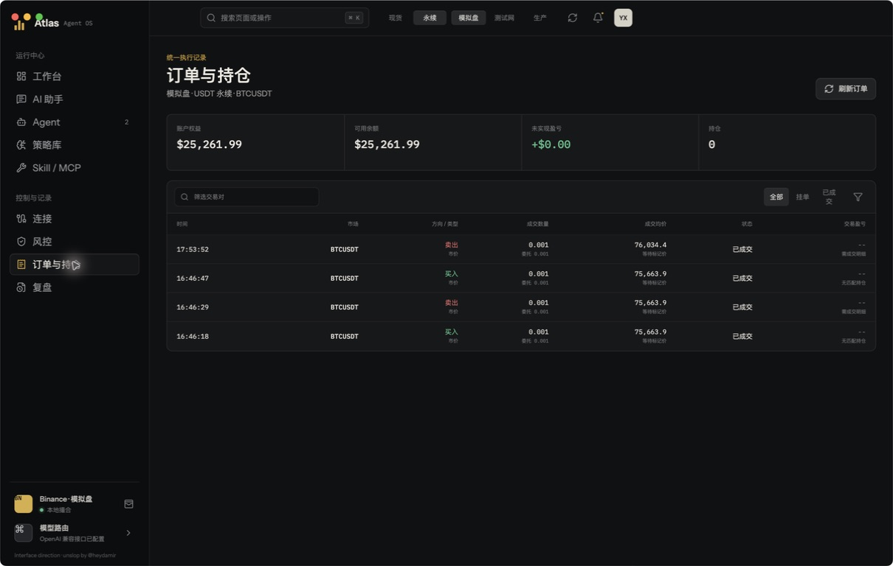

This screen synchronizes the selected environment and market, then provides:

- account equity, available balance, unrealized PnL, and non-zero asset/position count;
- symbol search, open/filled filters, latest/oldest ordering, and manual refresh;
- side, market/limit type, reduce-only marker, requested/executed quantity, average fill, mark price, and status;
- per-order PnL only when Atlas can safely attribute a realized result or match the order to a position/cost basis.

Atlas deliberately displays `--` instead of inventing PnL when Binance order history alone cannot prove the trade's cost basis or when fill/fee details are missing. Live position PnL remains visible on the workbench and risk views. Accurate long-term performance requires a complete fill, fee, funding, transfer, and cost-basis ledger.

### 11. Review and export

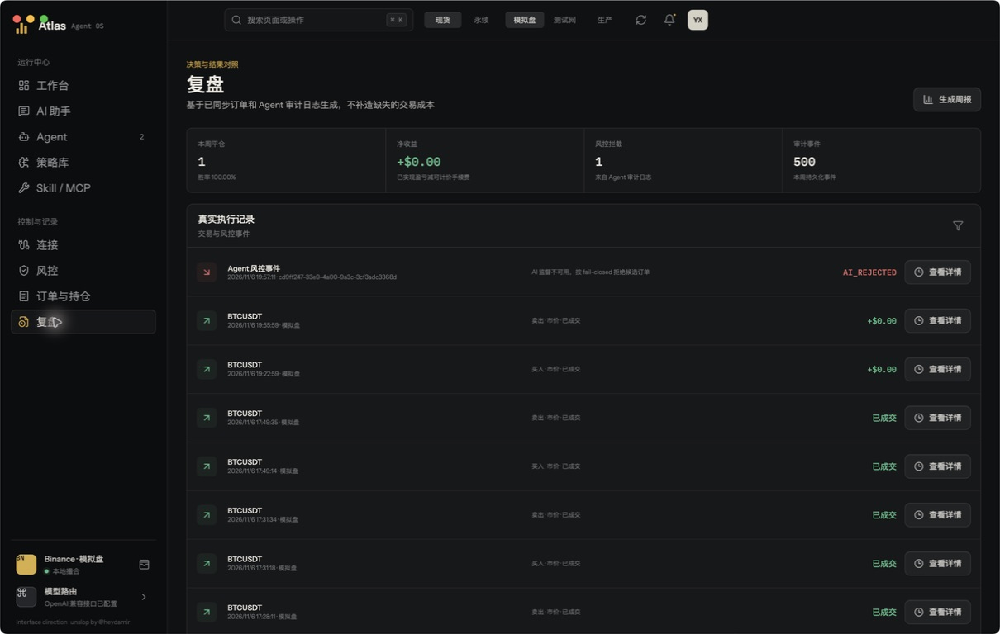

Review combines synchronized orders and persisted Agent logs. It summarizes weekly closed trades, attributable net realized PnL after countable fees, risk interceptions, and audit-event count. The filter cycles through all events, trades only, or risk rejections; **View details** opens the original record. **Generate weekly report** exports the locally assembled review as JSON without fabricating missing costs.

## Environments and markets

### Environment behavior

| Capability | Paper | Binance Testnet | Binance Live |
| --- | --- | --- | --- |
| Market data | Binance production public data | Testnet public endpoints | Production public endpoints |
| Balance/orders | Persistent local simulator | Signed Testnet REST | Signed production REST |
| API key required | No | Yes, Testnet credential | Yes, Live credential |
| Manual order confirmation | Normal order dialog | Normal order dialog | Explicit production confirmation; currently no TTL or confirmation-time repricing check |
| Agent execution | Automatic after risk approval | Automatic after risk approval | 30-second per-order confirmation, price refresh, risk recheck |
| Recommended use | UI/strategy workflow | Exchange integration validation; not production-liquidity simulation | Restricted small-size production validation only |

Credentials are environment-bound. Testnet keys are not reused for Live, and an environment mismatch is rejected before a signed request.

Paper uses separate persistent 25,000 USDT Spot/Futures ledgers plus Binance production public prices. It is a simplified simulator: no commissions, slippage, funding, depth, partial fills, or automatic liquidation; limit orders do not reserve balance and are checked as whole fills on account refresh. Its liquidation and margin values use a local fixed-maintenance approximation. Paper "today PnL" is cumulative since the simulated account was created, not a natural-day ledger.

For remote Futures, unrealized/risk data comes from account and `positionRisk`; daily PnL combines available UTC-day income records with current unrealized PnL and can degrade if income retrieval fails. For remote Spot, cost basis is unavailable, so return and portfolio daily PnL use 24-hour price-change estimates. Per-order realized Futures PnL can use trades, but fees in non-stable assets are not converted into a complete net ledger.

### Spot versus USDT-M Futures

| Capability | Spot | USDT-M Futures |
| --- | --- | --- |
| Direction | Buy/hold/sell; no naked short | Long and short |
| Position mode | Not applicable | One-way or hedge |
| Margin mode | Not applicable | Cross or isolated |
| Leverage | 1x | `1-125x`, subject to Binance rules |
| Margin adjustment | Not applicable | Add/remove on isolated positions |
| Closing | Sell available asset | Partial/full reverse order with correct position-side semantics |
| Risk fields | Paper: local weighted cost/PnL; remote: market value and 24h-change estimate | Latest displayed price; exchange mark/PnL and margin fields at account snapshots |

Before changing Futures margin or position mode, close incompatible positions and cancel conflicting open orders. Binance symbol filters and account permissions remain authoritative.

A close action submits an order; a market fill can slip and a limit close can remain open. Spot can sell only free quantity. Binance quantity/price/notional rounding can reject an order or leave dust, and the pre-submit unrealized PnL is not final realized PnL. Live Futures account-parameter changes act on the Binance account and require their own production confirmation.

## Binance setup

1. Create dedicated Testnet and/or Live Binance API credentials. Do not reuse a personal all-permission key.
2. Enable only the Spot and/or Futures trading permissions actually needed. Never enable withdrawals.
3. Add the machine's stable public IP to the key whitelist when possible.
4. In **Connections -> Configure Binance**, select the matching environment, enter the key/secret, and test the connection.
5. Verify symbol switching, account synchronization, a small manual order, cancellation/closing, and Agent logs in Paper first, then Testnet.
6. Only after independent Binance-side verification should Live be enabled with the smallest position size.

An API key does not remove Binance limits. Atlas reduces requests with shared WebSockets, reference-counted subscriptions, cached/paged history, and retry/backoff handling, but Binance can still throttle an IP or key with `418`, `429`, or `-1003`. An IP pool is neither required nor recommended for bypassing limits. Respect `Retry-After`, reduce subscriptions/request frequency, and use one stable whitelisted egress IP.

## Model setup

Atlas supports hosted APIs, local gateways, and local model servers. The saved connection is shared by Assistant and AI-supervised Agents.

- Use the provider's official endpoint whenever possible.
- For CCSwitch, enter the actual locally enabled proxy address; the default preset uses `http://127.0.0.1:15721/v1`.
- For Ollama or LM Studio, start the local server and load/install the intended model before testing.
- For an OpenAI-compatible gateway, choose the custom provider and enter its Base URL and exact model ID.
- A healthy connection is required for AI-supervised Agents. If it becomes unavailable, the Agent rejects the candidate order instead of silently reverting to strategy-only execution.

API keys are encrypted with Electron `safeStorage`. Status APIs redact fields whose names contain key, secret, token, or password.

## Skills and MCP setup

1. Enable only the built-in Skills needed by the Assistant.
2. Connect an HTTP MCP endpoint on the Skills/MCP page and verify discovered tools.
3. Edit the Agent, switch to AI-supervised mode, select applicable Skills, and explicitly allow individual MCP tools.
4. Set the confidence threshold and save the Agent.
5. Start in Paper and inspect the Agent timeline for applicability, AI decision, deterministic risk result, and final action. Raw MCP calls are not currently shown as their own timeline step; use the MCP server's logs for call-level verification.

An MCP tool should return analysis or structured data, not receive unrestricted account control. Tool availability is checked at execution time; unavailable authorized tools cause supervised execution to fail closed.

## Agent execution model

```text
Closed candle
    -> deterministic strategy signal
    -> optional Skill checks / allowlisted MCP tools / AI approval
    -> deterministic local risk checks
    -> Paper or Testnet execution
       OR Live confirmation intent (30 seconds)
    -> signed exchange request / local Paper fill
    -> response, fill, position reconciliation, persistent audit log
```

Agent definitions and append-only events live in the Electron user-data directory. The log is the primary record for understanding why an Agent waited, rejected, retried, submitted, or stopped. A strategy signal does not guarantee an order: stale data, duplicate candles, missing AI capability, low confidence, risk rejection, invalid exchange filters, insufficient margin, confirmation expiry, or exchange errors can all stop the chain.

## Backtest methodology

Backtests are local pure-function simulations over public historical K-lines and never call the order adapter.

- A run uses at most the latest 10,000 closed candles; newly listed symbols or limited data availability may return fewer, while rate limiting can pause or fail the read. Each market series can cache/paginate up to 20,000 candles.
- The current still-open candle is excluded using local time and the selected interval. Detected gaps do not stop calculation, but lower confidence in the result.
- Signals use only the current and earlier closed candles. They execute at the next candle's open reference price; a Futures reversal closes and reverses at that open, while a Spot sell signal only returns the strategy to flat. End-of-data closes at the last close reference.
- The final `20% / 30% / 40%` is one chronological exploratory holdout. Earlier data may warm indicators, but holdout equity/trades/statistics restart at the split. The first signal warm-up candle is not counted.
- Spot is long-only and fixed at 1x. Futures may trade long/short; notional exposure is position fraction times leverage, not a full Binance margin-account model.
- Orders are assumed to fill completely. Directionally adverse static slippage applies to entry/exit, and fees use slippage-adjusted notional. Depth, dynamic spread, impact, partial fills, latency, rejects, and retries are not simulated.
- Fixed stop, trailing stop, take-profit, and zero-equity thresholds use candle OHLC. If adverse thresholds and take-profit trigger in one candle, the adverse exit has priority; when several adverse thresholds trigger, the model chooses the one reached first from the open. A new trailing extreme becomes active on the next candle.
- Funding uses a user-supplied static eight-hour rate, direction, current opening notional, and elapsed time. It is not historical Binance funding and does not reproduce settlement timestamps.
- If costs or funding exhaust equity, equity becomes zero and cannot recover later.

Metric definitions:

- **Net return:** normalized equity change including trade PnL, fees, slippage, and signed funding cash flow.
- **1x long benchmark:** holdout first open to final close, without costs or leverage.
- **Maximum drawdown:** equity curve plus the model-selected adverse intrabar OHLC price, not an exact tick path.
- **Win rate:** net-positive closed trades divided by all closed trades; flat trades remain in the denominator. Zero trades is unavailable.
- **Profit Factor:** sum of net PnL from profitable trades divided by the absolute sum of net PnL from losing trades; positive profit with no loss is infinity, while no profit/no loss is unavailable.
- **Expectancy/payoff:** arithmetic mean net trade return; average winning return divided by absolute average losing return.
- **Sharpe:** candle-close equity returns, zero risk-free rate, annualized for a 365-day market. It is unstable for short windows and sparse trades.
- **Cost drag:** fees, slippage, and signed funding cash flow relative to normalized starting equity; funding income can reduce it. It is not a strict no-cost counterfactual.
- **MFE/MAE:** approximations based on OHLC, exit priority, and conservative path assumptions, not exchange tick reconstruction.

Fewer than 30 holdout trades triggers a warning, not statistical significance. Liquidation is a dynamic zero-equity termination approximation and does not reproduce Binance maintenance-margin tiers, mark-price rules, cross/isolated interactions, risk limits, or insurance rules. Repeatedly tuning after viewing the holdout contaminates it. Use locked validation windows, walk-forward tests, multiple symbols/intervals/regimes, and Paper/Testnet forward observation before considering Live.

## Installation and packaging

Requirements: Node.js `20.19+` or `22.13+` LTS, npm, and a macOS/Windows/Linux version supported by Electron.

```bash
git clone https://github.com/guoyuxin33/atlas-agent-os.git
cd atlas-agent-os
npm install
npm run desktop:dev
```

`desktop:dev` starts Vite on `127.0.0.1:5173` and opens the Electron window. Running only `npm run dev` exposes the renderer for development but does not provide the secure main-process trading APIs.

For a launch-time proxy:

```bash
ATLAS_PROXY_URL=http://127.0.0.1:7890 npm run desktop:dev
```

Verification and packaging:

```bash
npm run lint
npm run build
npm run verify
npm run desktop:pack
npm run desktop:dist
```

`npm run verify` covers public market pagination, all seven Agent strategies, backtest timing/risk/cost semantics, isolated Paper Futures behavior, and chat-session persistence. Paper verification uses a temporary user directory and does not submit Testnet or Live orders.

Desktop artifacts are written to `release/`. Local macOS packages are unsigned; public distribution requires code signing and notarization.

## Architecture and security

```text
Binance public streams -> Electron market hub -> renderer charts / Agent candles / AI context
User or Agent intent  -> main-process validation -> confirmation gate -> Binance signed REST
Model + Skill + MCP   -> analysis/approval only  -> deterministic risk gate -> audit log
```

- The renderer is sandboxed with `contextIsolation`; Node.js integration is disabled.
- Preload exposes a narrow IPC allowlist.
- Credentials are stored with OS-backed Electron `safeStorage`, and secrets do not return to the renderer.
- The application is single-instance to avoid duplicate local Agent runtimes.
- Market topics are reference-counted and restored after reconnect.
- No withdrawal API is implemented.

See [docs/architecture.md](docs/architecture.md) for process boundaries, data flow, exchange semantics, and scaling limits.

## Known boundaries

- Automated verification does not submit Testnet or Live orders. Signed paths exist but require validation with your own restricted credentials and account.
- Atlas is a single-machine workstation, not exchange-colocated HFT infrastructure. It does not promise microsecond latency, multi-node failover, or lossless execution during every network/exchange incident.
- Market parsing, IPC, signed REST, AI, and MCP currently share the Electron main-process event loop. Dedicated market/order workers, bounded queues, backpressure, latency SLOs, and durable idempotent reconciliation are future hardening work.
- Market data, acknowledgements, fills, and positions can temporarily diverge during reconnects. Monitor the Binance account independently.
- The current global risk view is not a complete institutional risk service. It has no account/strategy daily-loss limit, portfolio concentration limit, order-frequency limit, mandatory protective stop, persistent halt, or automatic cancel/flatten action. Production deployment still needs these controls, alerting, and tamper-resistant audit storage.
- AI and backtests can be wrong. Treat their output as decision support, not a profitability guarantee.

## Interface direction

The desktop UI follows a quiet-chrome, rich-data workstation direction. It was reviewed with the `unslop` method for spacing, color, icons, copy, typography, layout, detail, visuals, and motion.

Unslop method by [@heydamir](https://x.com/heydamir), CC BY 4.0.
