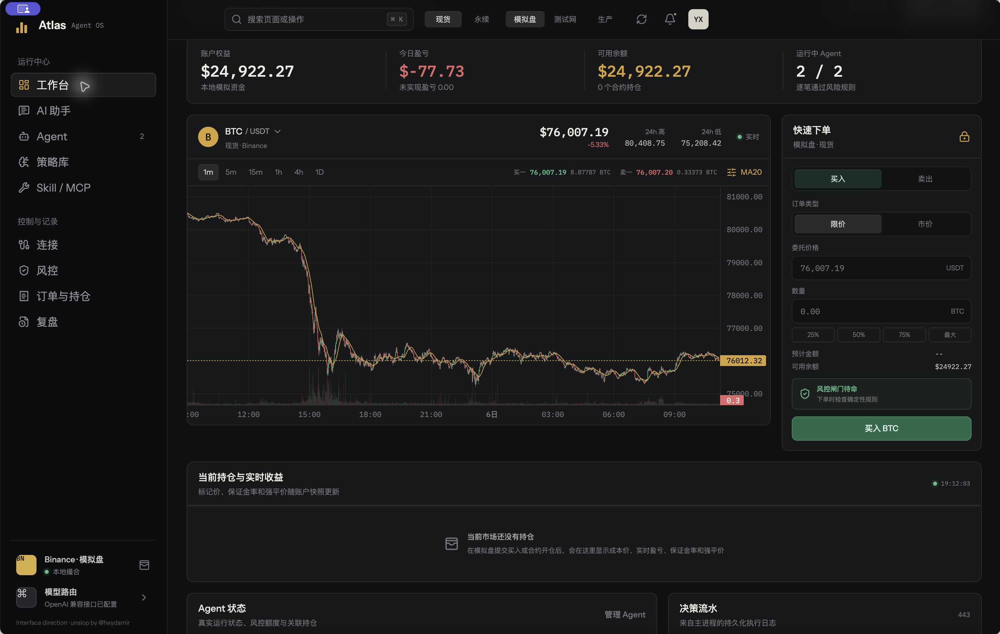
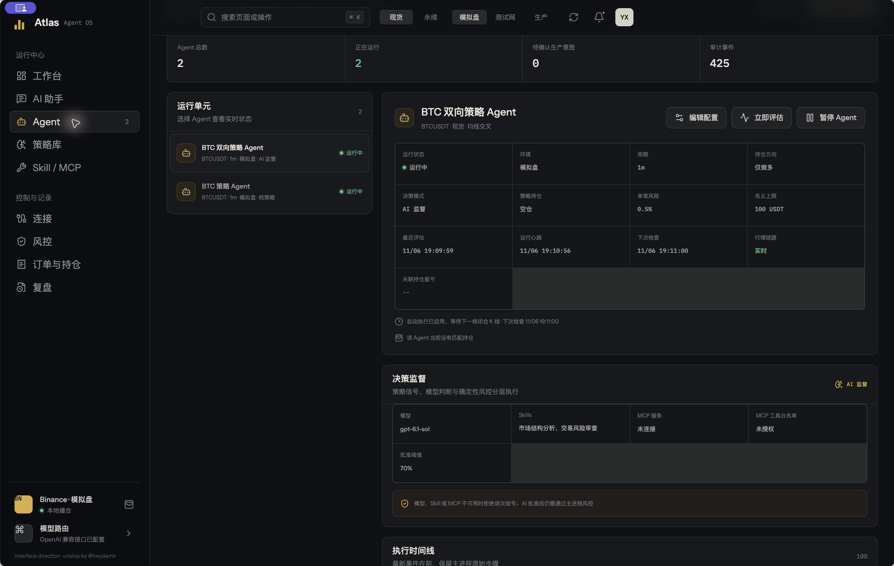
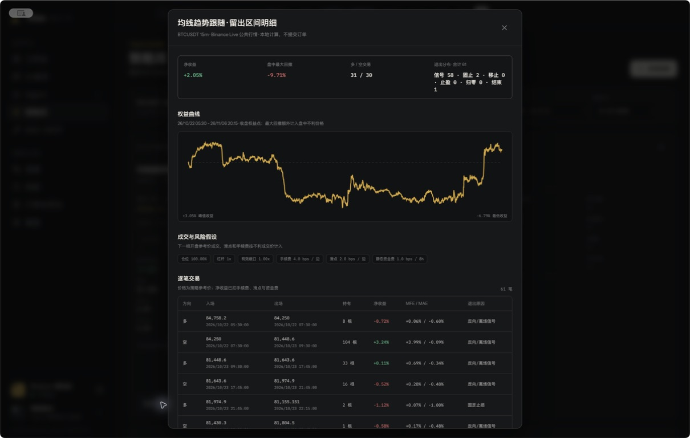

# Atlas Agent OS

[English](README.md) | [简体中文](README.zh-CN.md)

Atlas Agent OS 是一个面向数字资产交易的 Electron 桌面工作台。它把 Binance 行情、账户与订单、自动策略 Agent、AI 监督、Skills、MCP 工具、确定性风控和执行审计集中在一个原生桌面应用中。

> [!WARNING]
> Atlas 在配置生产环境后可以提交真实订单。请使用禁止提币、仅开放必要交易权限的专用 API Key，并配置 IP 白名单。考虑生产使用前，必须先在模拟盘和测试网完整验证策略。



## 已实现功能

### 交易工作台

- 模拟盘、Binance 测试网和生产环境，并提供明确的环境切换。
- Binance 现货和 U 本位永续合约行情、账户快照、挂单查询、订单提交和持仓操作。
- 现货/合约共享 WebSocket，支持动态订阅、自动重连、最优买卖价、24 小时行情和实时 K 线。
- 全交易所币种选择，支持 `1m / 5m / 15m / 1h / 4h / 1d` 周期，工作台最多加载 2,000 根历史 K 线。
- 模拟盘余额、成本、订单、合约持仓、已实现/未实现盈亏持久化，并支持重启恢复。
- 支持市价/限价开仓，以及在持仓表中部分或全部平仓。
- 合约支持单向/双向持仓、全仓/逐仓、`1-125x` 杠杆、逐仓保证金增减、强平价和保证金率。
- 每笔交易和组合收益随最新账户快照及标记价实时刷新。

现货不能建立无现货资产覆盖的裸空头。需要真正做多/做空时，请使用 U 本位永续合约。

### Agent 运行时与 AI

- 已有 Agent 可编辑，可配置交易对、现货/合约、环境、周期、策略、仅做多/仅做空/自动方向、单笔风险、名义金额上限和智能能力。
- 内置七类可运行策略：均线交叉、Donchian 突破、RSI 反转、布林带回归、ATR 突破、Supertrend 和 MACD 动量。
- Electron 主进程按闭合 K 线执行，支持立即评估、断线补偿、失败重试、运行状态持久化和逐步审计日志。
- 支持纯策略与 AI 监督两种决策模式。模型、Skill 或 MCP 不可用时 AI 监督会拒绝该次信号；AI 批准后仍须通过确定性风控。
- 每个 Agent 可独立选择 Skill、绑定 MCP 服务并配置 MCP 工具白名单。Skill 会按市场适用范围确定性过滤，并只接收受约束的行情、账户和候选订单输入。
- 生产 Agent 的每笔交易意图都需要人工确认，超时未确认会自动失效。



### 模型、对话、Skills 与 MCP

- AI 助手支持多个本地会话、历史记录持久化、Markdown 回答和当前市场上下文。
- 原生支持 Anthropic 与 Gemini 协议，同时支持 OpenAI-compatible Chat Completions/Responses。
- 提供 OpenAI、Anthropic、Gemini、DeepSeek、Qwen、Kimi、MiniMax、OpenRouter、CCSwitch、Ollama、LM Studio 和自定义兼容接口预设。
- 支持远程发现模型、手动输入模型，以及在厂商支持时选择不同推理强度。
- 提供六个版本化 Skill，覆盖市场状态、风险预算、执行质量、合约资金费率/清算风险、带来源新闻和策略一致性；每个 Skill 都声明必需、可选和禁止输入。
- 支持 Streamable HTTP MCP 工具发现/调用，并要求工具授权。当前暂不支持本地 stdio MCP Server。

### 策略复盘与桌面安全

- 七类本地回测策略与 Agent 默认逻辑对齐：EMA/SMA 交叉、Donchian、RSI、布林带、ATR 突破、Supertrend 和 MACD 动量。
- 单次策略回测可选择最多 10,000 根已闭合 K 线，并配置 `20% / 30% / 40%` 按时间切分的探索性留出区间；行情服务最多缓存并增量分页 20,000 根，不会在扩展样本时重复拉取最新页。
- 信号在收盘确认并于下一根开盘成交，避免未来函数；支持现货仅做多、合约做空/杠杆、固定止损、移动止损、止盈、仓位、按当前名义价值估算资金费、按成交价计费和滑点。
- 结果分别显示样本内与留出区间日期，标记少量交易样本，常驻展示成本假设，并提供净收益、1x 标的基准、盘中最大回撤、胜率、Profit Factor、期望、盈亏比、Sharpe 和成本拖累。
- 可审计详情展示留出权益曲线与每笔交易的方向、进出场参考价、净收益、MFE/MAE 和退出原因。
- 提供订单、持仓、Agent 日志、复盘和导出视图。
- 凭证通过 Electron `safeStorage` 加密，Secret 不会返回渲染进程。
- 启用 `contextIsolation` 和渲染器沙箱，禁用 Node.js 集成，并限制应用只能启动一个实例。
- Binance、远程模型和 MCP 共用 HTTP/HTTPS 代理，本地服务自动直连。
- 不实现提币接口，也不具备提币能力。



## 本地运行

需要 Node.js `20.19+` 或 `22.13+` LTS 与 npm，以及 Electron 支持的 macOS、Windows 或 Linux。

```bash
npm install
npm run desktop:dev
```

该命令会启动 Vite 和 Electron 桌面窗口。Atlas 的目标是桌面交易软件，不是仅在浏览器内运行的交易网页。

如果当前网络无法直连 Binance，可在 **连接 > 网络出口** 中配置 HTTP/HTTPS 代理，或在启动前设置：

```bash
ATLAS_PROXY_URL=http://127.0.0.1:7890 npm run desktop:dev
```

位于 `localhost`、`127.0.0.1` 和 `::1` 的 CCSwitch、模型及 MCP 服务会自动绕过代理。

## 配置 Binance

1. 打开 **连接**，配置测试网或生产环境的 Binance 凭证。
2. 只授予实际需要的现货和/或合约交易权限，不要授予提币权限。
3. 条件允许时，把 API Key 限制到当前机器的稳定公网 IP。
4. 先验证模拟盘，再验证测试网，最后才考虑切换到生产环境。

申请 API Key 并不会取消 Binance 的请求限制。Atlas 通过共享 WebSocket 和缓存减少请求量，但交易所仍可能按 IP 或 API Key 限流。不需要也不建议使用 IP 池绕过限流；应遵守 Binance 的限制与退避信号。

## 配置模型

打开 **连接 > 模型与推理**，选择模型厂商，填写服务地址和 API Key，从接口发现的模型中选择或手动输入模型名，设置厂商支持的推理强度，然后执行连接测试。CCSwitch 等 OpenAI-compatible 网关可以填写自己的 Base URL。

## 验证与打包

```bash
npm run lint
npm run build
npm run verify
npm run desktop:pack
npm run desktop:dist
```

`npm run verify` 覆盖公共行情及分页、七类回测策略、下一根开盘/风控/成本口径、隔离的模拟合约行为和 AI 会话持久化。模拟盘验证使用临时用户目录，不会向测试网或生产环境提交订单。

桌面构建产物输出到 `release/`。本地 macOS 构建未签名；公开分发需要完成平台签名和公证。

## 安全与运行边界

- 开发验证期间没有执行测试网或生产订单。签名交易链路已经实现，但必须使用你自己的受限账户和凭证验证。
- 生产订单需要在桌面应用内明确确认，模型不能绕过确认或确定性风控。
- Atlas 是单机交易工作台，不是交易所共置的高频交易系统，不承诺微秒延迟、多节点协调或在所有网络/交易所故障下无损执行。
- 重连或交易所异常期间，行情、订单回执、成交和持仓可能短暂不一致；请同时监控执行日志与 Binance 账户。
- 回测资金费使用用户填写的静态估算，强平使用动态零权益近似；两者不等同于 Binance 历史资金费与维持保证金档位。反复根据探索性留出结果调参会污染留出集，因此它不是样本外表现或未来收益的证明。
- 数字资产交易风险很高。本项目是工程软件，不构成投资建议，也不保证盈利。

进程边界、数据流和当前扩展限制见[架构说明](docs/architecture.md)。

## 界面方向

桌面界面采用 quiet chrome / rich data 的交易工作台方向，并使用 `unslop` 方法检查间距、颜色、图标、文案、排版、布局、细节、视觉和动效。

Unslop method by [@heydamir](https://x.com/heydamir), CC BY 4.0.
